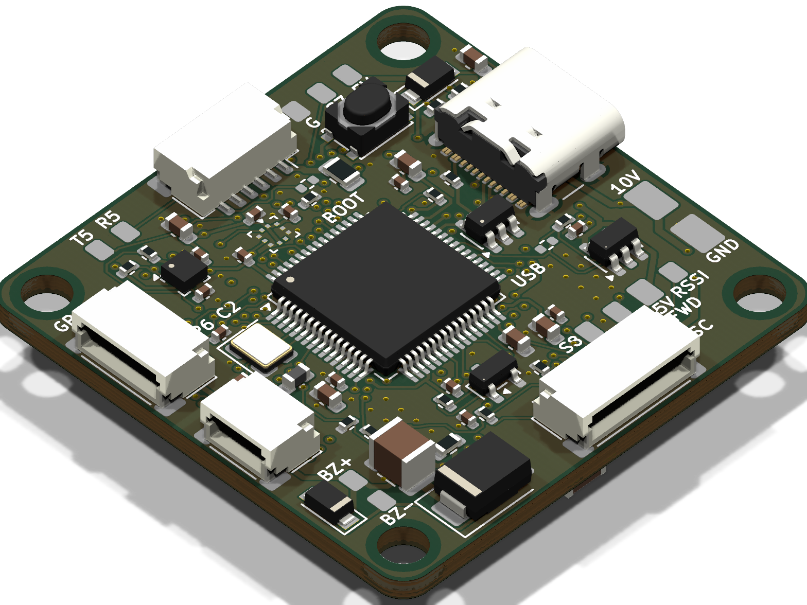
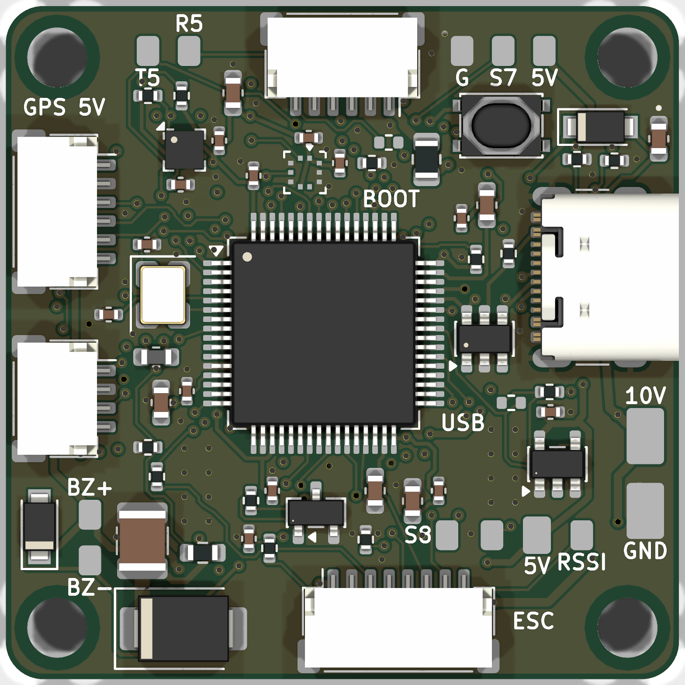
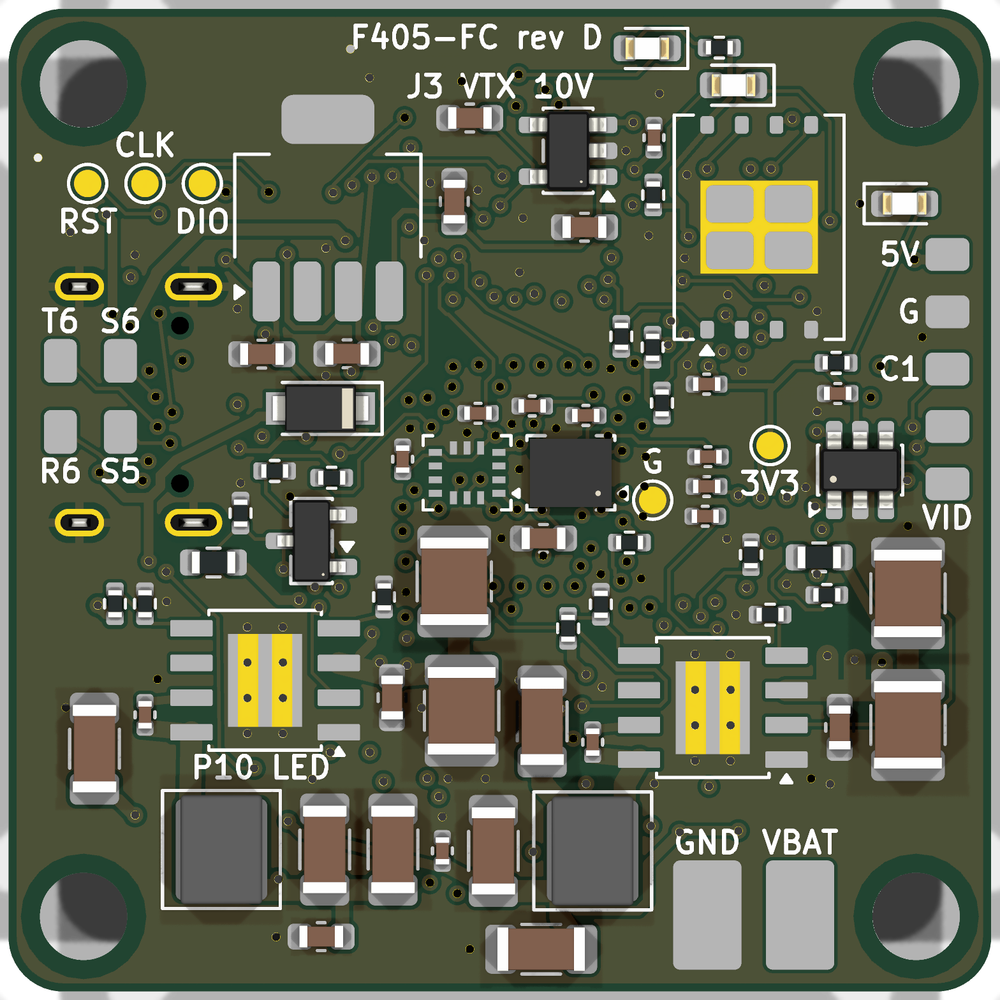

# F405-FC

STM32F405 flight controller for 30.5 mm quadcopter stacks. 2–6S input, dual IMU, Betaflight and INAV targets. Every part is sourced from DigiKey.

| Top | Bottom |
|---|---|
|  |  |

> **Status: rev D, design complete, not yet built.** DRC and ERC are clean, and every review gate's major findings are fixed and re-reviewed. Nothing has been fabricated, powered or flashed yet. See [review/summary.md](review/summary.md) for open risks and the list of what wasn't verified.

## Specs

| | |
|---|---|
| MCU | STM32F405RGT6, 168 MHz, LQFP-64 |
| IMUs | ICM-42688-P + BMI270 (SPI1, separate CS and INT) |
| Barometer | BMP390 (I2C1) |
| Magnetometer | IIS2MDC (I2C1), plus external I2C on the GPS port |
| Blackbox | W25N01GV, 1 Gbit SPI NAND |
| Input | 2–6S, SMBJ26A TVS, VBAT/GND solder pads |
| Regulators | 2× LMR38020 synchronous buck (5 V, and 10 V switchable for VTX pit mode), LP38692 3.3 V, LP5907 low-noise 3.3 V for the IMUs |
| Video | HD digital VTX port (MSP DisplayPort OSD) on a JST-SH 6-pin, analog camera switch (TS5A3159A) between two cameras |
| Outputs | 8 motor/servo outputs (M1–M4 on the ESC connector support bidirectional DShot), WS2812 LED strip, buzzer |
| I/O | 6 UARTs, USB-C (USB 2.0 FS, ESD protected), JST-SH ESC 8-pin, GPS 6-pin, ELRS 4-pin |
| Board | 36 × 36 mm, 30.5 mm M3 mounting, 6 layers (solid GND on In1/In4), 1.6 mm |
| Assembly | Hand / hot-air with stencil, 0402 minimum, no BGA |

There's no analog OSD. The AT7456E has no DigiKey listing and the MAX7456 is obsolete, so OSD comes over MSP DisplayPort (see [D-01](design/decisions.md)).

## Repository layout

| Path | Contents |
|---|---|
| `kicad/` | KiCad 10 project: hierarchical schematic, board, design rules |
| `fab/` | JLCPCB Gerber/drill zip, stencil, placement (CPL) files |
| `bom/` | DigiKey BOM Manager CSV, costed BOM (~$173 for 2 boards plus spares), interactive HTML BOM |
| `docs/` | Schematic PDF, STEP, renders, Betaflight config, INAV target, [assembly and bring-up guide](docs/assembly_and_bringup.md) |
| `design/` | Requirements, pin map and DMA plan, power design, decision log |
| `review/` | Reports from each review gate (pin map, power, schematic, sourcing, footprints, placement, SI/PI, DFM, red team) |
| `gen/` | Python generators: circuit model → schematic → board, routing helpers, checks |
| `lib/` | Custom footprints |

## How it was made

The design was generated from a Python circuit model (`gen/`) into KiCad 10. It was routed with a mix of scripted critical routes and Freerouting. It then went through staged reviews, each done by independent agents told to assume mistakes exist and to cite evidence:

0. pin map and power
1. schematic
2. sourcing and footprints
3. placement
4. signal and power integrity
5. manufacturability
6. two red teams (first power-up and Betaflight bring-up)

Each gate looped through fixes and re-review until no blocking or major findings remained. The previous 4-layer rev C is kept on branch [`rev-c`](../../tree/rev-c); it isn't recommended.

## Before ordering

- Upload `bom/F405FC_digikey_bom.csv` to DigiKey's BOM Manager to confirm live stock and prices. Stock was checked only through dated web snapshots.
- Choose the JLCPCB 6-layer stackup and order **epoxy-filled, capped vias (POFV)**, since some vias are in or next to pads.
- Follow the bring-up guide: check the rails on a current-limited supply before fitting the MCU.
